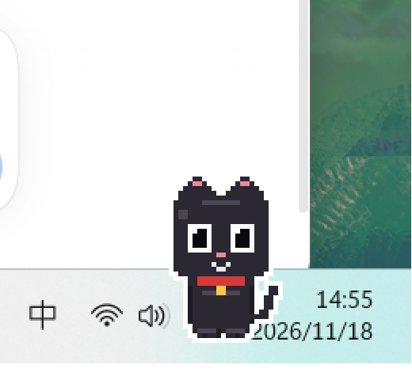

# 喵伴 MiaoBan

一只住在 Windows 桌面上的像素猫。单文件 exe，约 70KB，免安装、不联网、不写系统目录。

- **在线**：<https://pengyuyan3d.github.io/miaoban/>
- **下载**：<https://github.com/pengyuyan3d/miaoban/releases/latest>



## 它能做什么

| 行为 | 触发 | 说明 |
|---|---|---|
| 踩奶 / 敲键盘 | 你打字 | 爪子底下会出现一个小键盘，左右爪交替 |
| 过热 | 连续快速打字 | 变成红色、头顶冒蒸汽（约 1.4 秒连续输入） |
| 追鼠标 | 右键「去追鼠标」 | 上下左右都能追，鼠标移动快时也会自己追 |
| 摸头 | 左键单击 | 眯眼笑、冒爱心、气泡「喵~」 |
| 睡觉 | 120 秒无输入 | 趴下、冒 z |
| 伸懒腰 | 45 分钟久坐提醒 | 身体拉长 |
| 番茄钟 | 右键「开始专注」 | 猫头顶浮一个倒计时 |
| 喝水提醒 | 45 分钟 | 气泡提示 |
| 拖动 | 按住拖 | 像麻薯一样拉长，松手回弹 |
| 闲逛 | 随机 | 自己在桌面上跳来跳去 |

右键菜单：摸摸头 / 专注 25 分钟 / 起来动一动 / 去追鼠标 / 小一点·中号·大一点 / 总在最前 / 喝水提醒 / 久坐提醒 / 开机自动出现 / 关于 / 退出。

## 技术要点

- **纯 C#，零第三方依赖**，只用 .NET Framework 自带的 WinForms + GDI+
- **分层窗口 + 逐像素 alpha**：`UpdateLayeredWindow` + DIB section，自己做了 alpha 预乘
- **像素画**：32×36 手绘网格，逐行定义剪影，白色描边由轮廓自动外扩生成
- **不抢焦点**：`WM_MOUSEACTIVATE → MA_NOACTIVATE`，点猫不会打断你打字
- **原生右键菜单**：`TrackPopupMenu`，避免分层窗口下 ToolStrip 收不到点击
- 高 DPI（PerMonitorV2）、单实例、配置持久化

## 编译

需要 Windows + .NET Framework 4.x（系统自带）：

```powershell
powershell -ExecutionPolicy Bypass -File build.ps1
```

输出 `dist\MiaoBan.exe`。

## 目录

```
src/
  MiaoBan.cs      主程序：窗口、行为、菜单、托盘
  CatArt.cs       姿态合成：帧选择、染色、粒子
  Sprite.cs       像素画：32×36 网格逐行定义 + 白描边
  MenuForm.cs     （旧）自绘菜单，已被原生菜单替代
  AssemblyInfo.cs 版本信息
build.ps1         一键编译
art/              导出的形象 PNG / 图标
商品图/            上架用图
验证截图/           实测截图
```

## 已知限制

- 只在 Win10 / Win11 实测，Win7 未测
- 键盘钩子会被部分安全软件拦截；拦不到时退化成「检测到活动就踩奶」
- 无签名证书，首次运行可能有 SmartScreen 提示
- 侧面走路只有 4 帧，仍然粗糙

## License

代码 MIT。像素形象为原创，随仓库以 CC BY 4.0 授权（署名：喵伴 / MiaoBan）。


## 换一只猫（定制）

猫的形象不在代码里，而在 `sprite.cat`（纯文本像素画）。把 `sprite.cat` 放到 `MiaoBan.exe` 同目录，重启程序即可换猫，**不用改代码、不用重新编译**。

```powershell
# 1. 导出一份模板
.\dist\MiaoBan.exe --export-pack my-cat.cat

# 2. 改颜色（最简单）
#    把 color.r=D63A36 改成 color.r=2F6BFF，项圈就变蓝了

# 3. 预览（不启动程序）
.\dist\MiaoBan.exe --preview-pack my-cat.cat preview.png

# 4. 校验帧是否齐全
.\skill\desktop-pet-customizer\scripts\check-pack.ps1 -Pack my-cat.cat

# 5. 打包交付
.\skill\desktop-pet-customizer\scripts\package.ps1 -Name "客户名-橘猫" -Pack my-cat.cat
```

帧格式与逐像素画法见 `skill/desktop-pet-customizer/references/sprite-format.md`。

## 定制流程（skill）

`skill/desktop-pet-customizer/` 是一份可安装的 skill：把「照片 → 像素猫 → 编译 → 打包」沉淀成固定步骤，含质量红线和常见坑。

````
skill/desktop-pet-customizer/
  SKILL.md                     流程、红线、定价边界
  references/sprite-format.md  素材包格式与画法
  scripts/export-pack.ps1      导出模板
  scripts/preview-pack.ps1     渲染对照图
  scripts/check-pack.ps1       校验尺寸与帧
  scripts/package.ps1          打交付 zip
````
